# 자바웹프로그래밍 | 2~7주차 실습 기록

**성결대학교 미디어소프트웨어학과 · 20230968 기경민**

개인 포트폴리오에서 MySQL 연동, 로그인·권한 관리, REST API까지 확장한 Spring Boot 프로젝트입니다. 주차별 구현 내용, 연습문제와 실제 실행 화면을 한 페이지에 정리했습니다.

[2주차](#week-02) · [3주차](#week-03) · [4주차](#week-04) · [5주차](#week-05) · [6주차](#week-06) · [7주차](#week-07) · [실행 방법](#run)

| 개발 환경 | 구성 |
| --- | --- |
| 서버 | Java 26 · Spring Boot 4.1.1 · Maven |
| 화면 | Thymeleaf · Bootstrap 5 · Bootstrap Icons · JavaScript fetch |
| 데이터·보안 | MySQL `spring` · Spring Data JPA · Spring Security · BCrypt |
| 테스트 | JUnit · MockMvc · H2 |

> 아래 화면은 **2026-10-24 VS Code 프로젝트를 실행하여 실제 DB와 기존 계정으로 캡처**했습니다. 관리자 화면은 기존 `admin` 계정, 회원 검색은 기경민(`rlrudals13`) 데이터를 사용했습니다. 이미지를 클릭하면 원본 크기로 볼 수 있습니다.

<a id="week-02"></a>
## 2주차 | 개발 환경 설정과 기본 테스트

Spring Boot 프로젝트를 실행하고 Controller에서 URL을 연결했습니다. Thymeleaf로 서버 데이터를 화면에 출력하며 요청 → Controller → Model → View 흐름을 확인했습니다.

**연습문제:** `/hello2`에 이름, 학번, 과목, 주차와 메시지를 전달했습니다. 주요 파일: `DemoController.java`, `hello.html`, `hello2.html`.

[](docs/images/weeks/week02-hello2.png)

<a id="week-03"></a>
## 3주차 | 나만의 포트폴리오

템플릿을 개인 포트폴리오로 수정했습니다. 프로필 사진·크기를 조정하고 자기소개와 일대기, 연락 영역, 웹·AI·보안·게임 분야의 상세 페이지와 가격을 구성했습니다.

| 메인 포트폴리오 | 자기소개·일대기 |
| --- | --- |
| [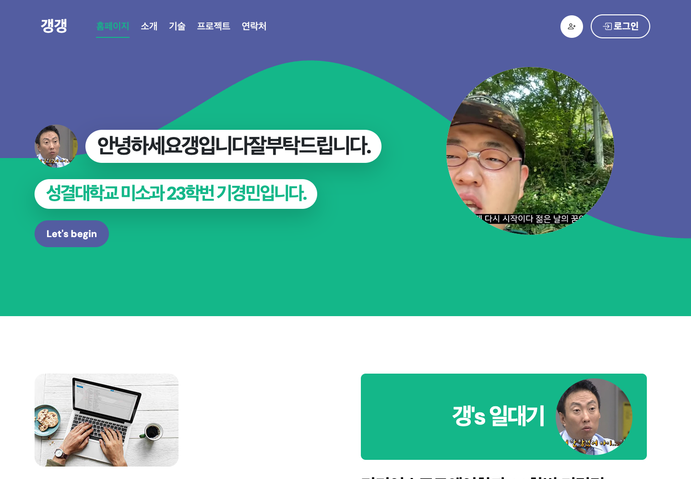](docs/images/weeks/week03-portfolio.png) | [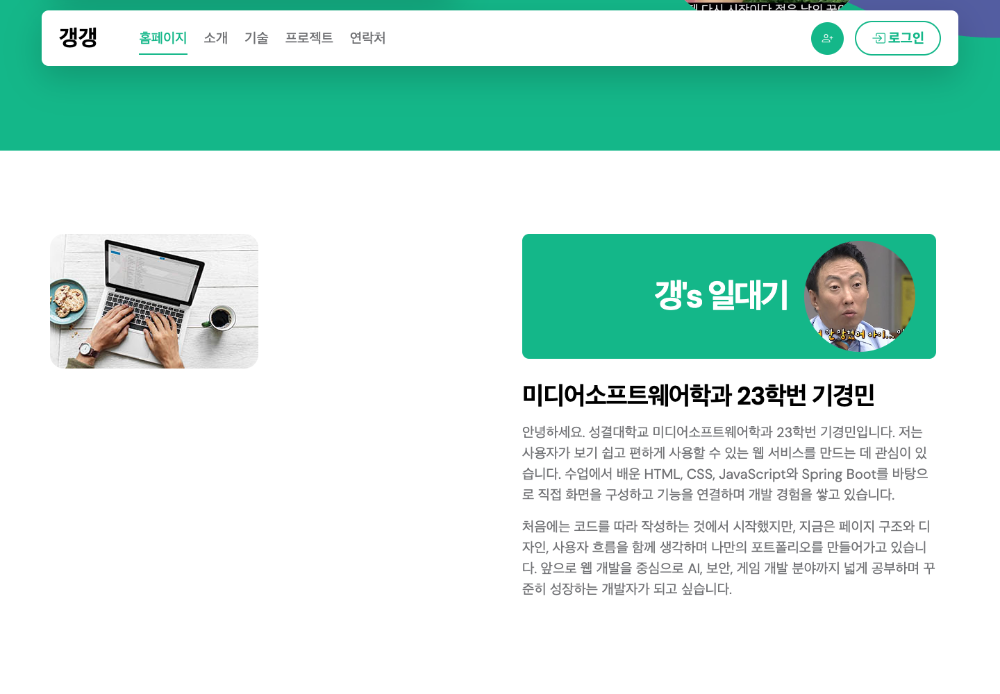](docs/images/weeks/week03-about.png) |

<details>
<summary>게임 상세 페이지 보기</summary>

[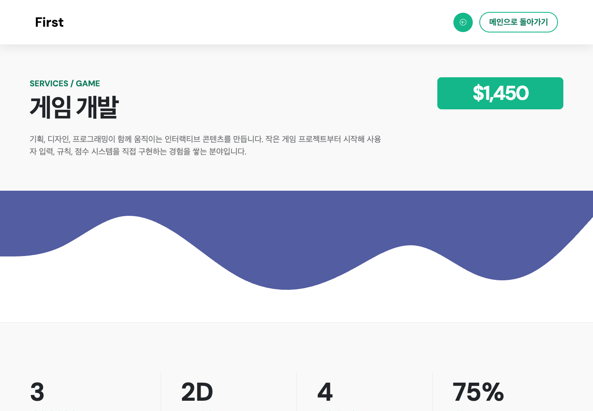](docs/images/weeks/week03-game.png)

상세 주소: `/detailed_web.html`, `/detailed_ai.html`, `/detailed_security.html`, `/detailed_game.html`.

</details>

<a id="week-04"></a>
## 4주차 | MySQL 데이터베이스 연동

MySQL의 `spring` DB에 연결하고 Entity → Repository → Service → Controller 구조를 구성했습니다. `/testdb`에서 이름 검색 결과, 전체 데이터 수와 회원 목록을 출력합니다.

**확인:** 실제 DB에서 홍길동 검색 결과와 샘플 데이터 3건을 조회했습니다. 주요 파일: `TestDB.java`, `TestRepository.java`, `TestService.java`, `testdb.html`.

[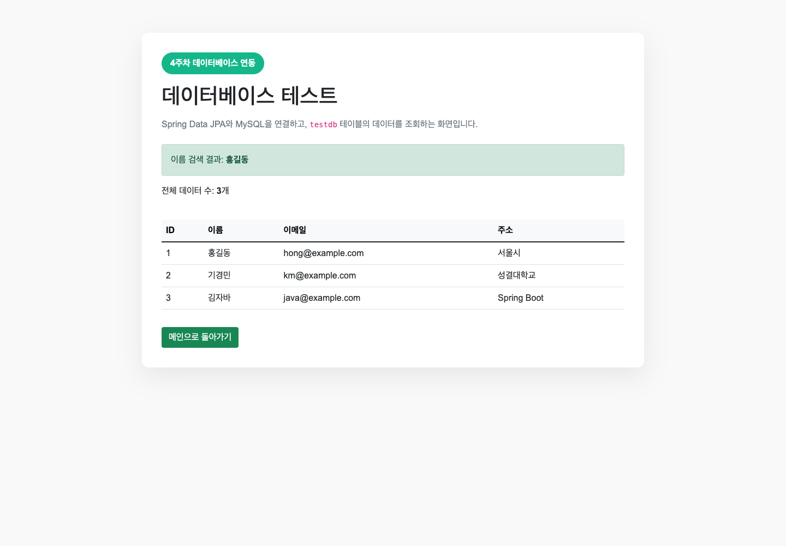](docs/images/weeks/week04-database.png)

<a id="week-05"></a>
## 5주차 | 회원가입·로그인·로그아웃

Spring Security로 회원가입, 세션 로그인·로그아웃과 로그인 상태 유지(remember-me)를 구현했습니다. 회원가입 시 빈 값, 중복 아이디, 비밀번호 확인을 검사하고 비밀번호는 BCrypt 해시로 저장합니다.

| 로그인 · 상태 유지 | 회원가입 · 입력 검증 |
| --- | --- |
| [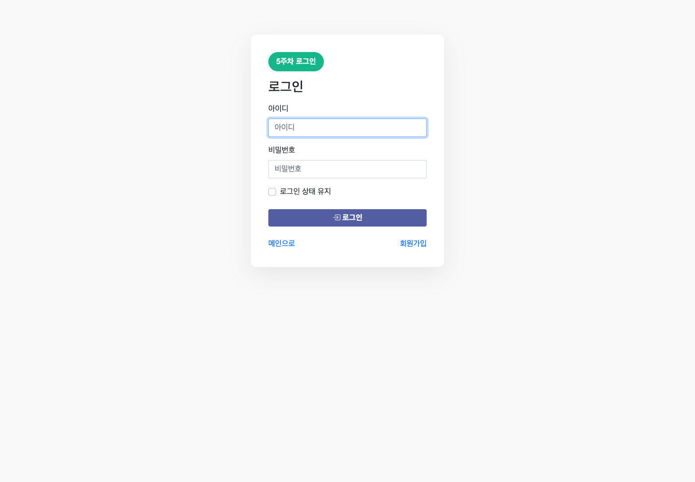](docs/images/weeks/week05-login.png) | [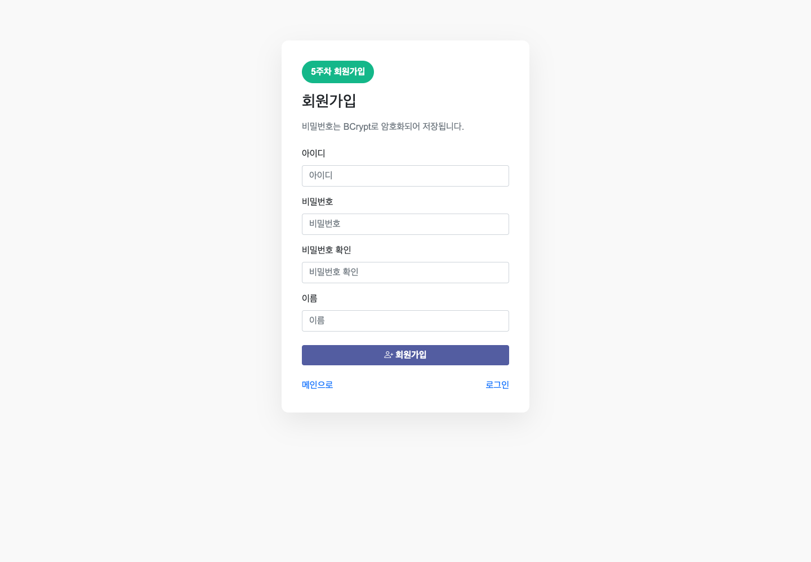](docs/images/weeks/week05-signup.png) |

<a id="week-06"></a>
## 6주차 | 권한 관리와 관리자 페이지

USER·MANAGER·ADMIN으로 권한을 구분하고 관리자 회원 목록, 권한 변경·삭제, 내 정보와 403 화면을 구현했습니다. URL 접근 제어와 서비스의 `@PreAuthorize`를 함께 적용했습니다.

**연습문제:** 관리자의 본인 권한 변경·삭제를 차단하고, `/testdb`는 ADMIN·MANAGER만 접근하도록 설정했습니다. 캡처에서는 기존 `admin`의 본인 권한 변경이 차단되어 실제 권한이 ADMIN으로 유지되는 것을 확인했습니다.

| 실제 회원 목록 · 권한 관리 | 관리자 본인 권한 변경 차단 |
| --- | --- |
| [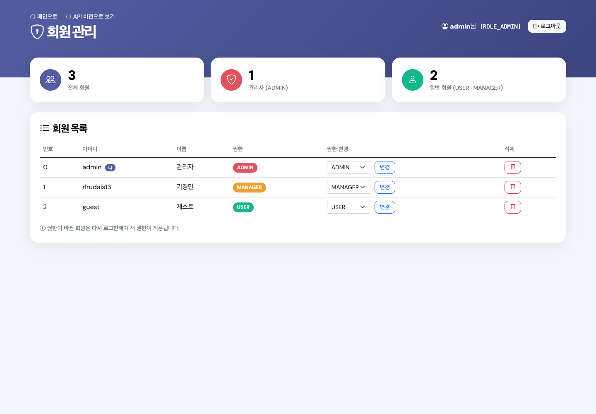](docs/images/weeks/week06-admin.png) | [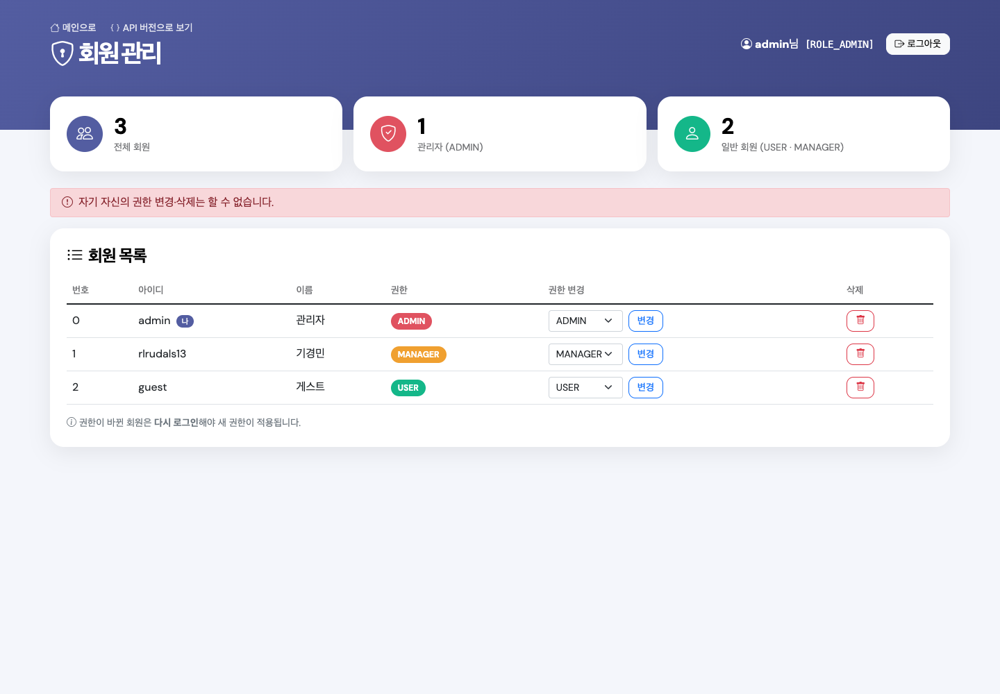](docs/images/weeks/week06-self-protection.png) |

<details>
<summary>기존 계정의 내 정보 보기</summary>

[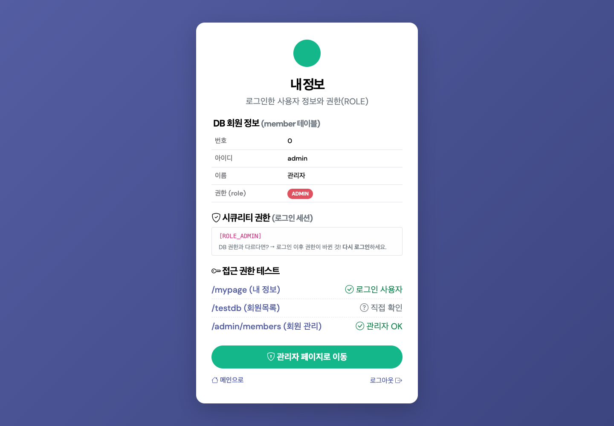](docs/images/weeks/week05-mypage.png)

</details>

<a id="week-07"></a>
## 7주차 | REST API와 JSON

회원 조회·등록·권한 변경·삭제를 JSON API로 구현하고 제공 코드의 fetch 화면을 연결했습니다. `MemberResponse`로 비밀번호·해시를 응답에서 제외하고 브라우저 세션 인증과 Postman Basic 인증을 지원합니다.

**연습①:** 아이디 또는 이름에 검색어가 포함된 회원 검색. 공백·영문 대소문자를 처리하며 검색어가 없으면 전체 목록을 반환합니다. 실제 이름인 ‘기경민’으로 검색하여 `rlrudals13` 회원을 확인했습니다.

**연습②:** `@RestControllerAdvice`로 오류 처리를 통합하고 잘못된 요청은 `400 + {"error":"메시지"}`로 반환합니다.

| 회원 검색 · 200 JSON 응답 | 필수 값 누락 · 400 오류 응답 |
| --- | --- |
| [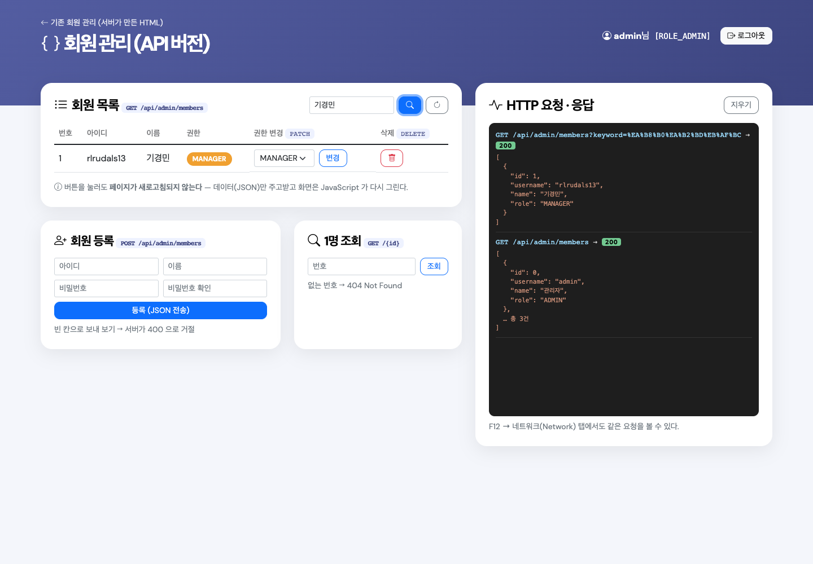](docs/images/weeks/week07-api-search.png) | [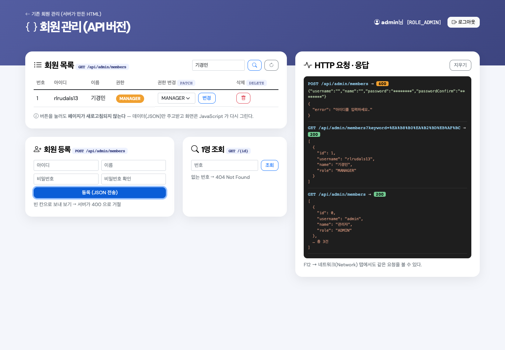](docs/images/weeks/week07-api-error.png) |

<details>
<summary>REST API 주소와 테스트 방법 보기</summary>

| 메서드 | 주소 | 접근 / 응답 |
| --- | --- | --- |
| GET | `/api/hello` | 공개 / 200, 인사·시간 |
| GET | `/api/me` | 로그인 회원 / 200, 내 정보 |
| GET | `/api/admin/members?keyword=기경민` | ADMIN / 200, 목록·검색 |
| GET | `/api/admin/members/{id}` | ADMIN / 200, 없으면 404 |
| POST | `/api/admin/members` | ADMIN / 201 + Location 헤더 |
| PATCH | `/api/admin/members/{id}/role` | ADMIN / 200, 변경된 회원 |
| DELETE | `/api/admin/members/{id}` | ADMIN / 204, 본문 없음 |

등록 JSON은 `username`, `password`, `passwordConfirm`, `name`입니다. 신규 회원은 요청에 `role`을 추가해도 USER로 저장하며, 권한 변경은 `{"role":"MANAGER"}` 형식입니다. 응답에는 `id`, `username`, `name`, `role`만 포함합니다.

Postman은 **Authorization → Basic Auth**에 실제 가입한 계정을 입력하고 **Body → raw → JSON**으로 요청합니다. 미인증 API는 401, 관리자 권한 부족은 403을 반환합니다. 실습 조건에 따라 `/api/**`만 CSRF 검사에서 제외하며 HTML 폼은 검사를 유지합니다. Basic 인증의 외부 서비스 사용에는 HTTPS가 필요합니다.

```bash
curl http://localhost:8080/api/hello
curl -u admin 'http://localhost:8080/api/admin/members?keyword=student'
```

두 번째 명령은 관리자 비밀번호를 별도로 입력받습니다.

</details>

<a id="run"></a>
## 실행 및 검증

프로젝트는 VS Code에서 실행했습니다. 먼저 MySQL이 실행 중인지 확인하고, 수업 자료에 맞춰 `spring` 데이터베이스를 사용하도록 설정했습니다. DB 접속 정보는 `src/main/resources/application-secret.properties`에 따로 작성하고 Git에 올라가지 않도록 제외했습니다.

```sql
CREATE DATABASE IF NOT EXISTS spring CHARACTER SET utf8mb4 COLLATE utf8mb4_unicode_ci;
```

VS Code 터미널에서 아래 명령으로 서버를 실행한 뒤, 브라우저에서 `http://localhost:8080/`에 접속해 화면을 확인했습니다.

```bash
./mvnw spring-boot:run
```

관리자 기능은 기존 `admin` 계정으로 로그인해서 확인했습니다. 관리자 계정을 처음 설정할 때는 회원가입 후 [관리자 권한 SQL](관리자_권한_부여.sql)을 실행하고, 로그아웃했다가 다시 로그인해야 변경된 권한이 적용됩니다.

| 기능 | 주소 | 접근 권한 |
| --- | --- | --- |
| 포트폴리오·기본 실습 | `/`, `/hello`, `/hello2` | 공개 |
| 회원가입·로그인 | `/signup`, `/login` | 공개 |
| 내 정보 | `/mypage` | 로그인 회원 |
| DB 조회 | `/testdb` | ADMIN·MANAGER |
| 관리자 화면 | `/admin/members`, `/admin/members-api` | ADMIN |

**실행하면서 확인한 내용**

로그인한 뒤 DB 조회 화면에서 데이터가 나오는지 확인했습니다. 관리자 화면에서는 실제 회원 목록과 권한을 확인하고, `admin` 자신의 권한을 변경하려고 했을 때 오류 메시지가 나오면서 기존 권한이 유지되는 것도 확인했습니다.

7주차 API 화면에서는 이름에 ‘기경민’을 입력해 제 계정인 `rlrudals13`이 검색되는지 확인했습니다. 검색 요청은 200으로 응답했고, 회원 등록 내용을 비워서 보내면 400과 함께 입력 오류 메시지가 나왔습니다. 화면 오른쪽의 요청·응답 기록을 보면서 결과를 확인할 수 있었습니다.

자동 테스트는 아래 명령으로 실행했으며, H2·MockMvc를 사용하는 테스트 7개가 통과했습니다.

```bash
./mvnw test
```

**실습 중 수정한 부분**

프로필 사진이 적용되지 않거나 크기가 맞지 않는 문제는 이미지 경로와 크기 설정을 수정했습니다. 회원가입 화면 오류는 HTML 속성의 따옴표 누락을 수정했고, DB 연결은 기존 설정을 확인해 수업에서 사용하는 `spring` DB에 맞췄습니다.

API에서는 로그인하지 않았을 때 로그인 화면 HTML 대신 401을 반환하도록 설정했습니다. 회원 엔티티를 그대로 반환하면 비밀번호 해시까지 나갈 수 있어서 응답 DTO에는 필요한 정보만 담았습니다. 이번 실습을 통해 화면이 정상적으로 보이는지뿐 아니라 권한과 응답 데이터, 상태 코드도 함께 확인해야 한다는 점을 정리할 수 있었습니다.
